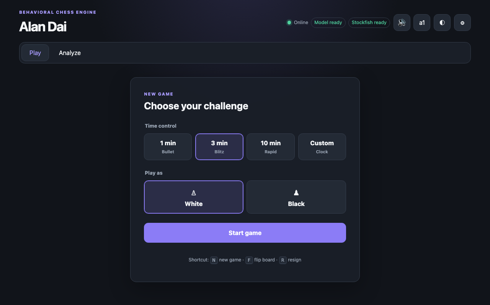

# ChessBot — personal chess behavior modeling

[](https://github.com/dcw06/ChessBot/actions/workflows/ci.yml)

A playable chess application combining an ONNX behavioral-cloning policy with an opening book, tactical rules, and an optional Stockfish safety filter. The model was trained on 10,297 personal games; the application adds board analysis, move history, and desktop/mobile layouts.

**[Play the deployed application](https://playalandaiatchess.org) · [Evaluation](#held-out-evaluation) · [Setup and operations](docs/OPERATIONS.md) · [CI](https://github.com/dcw06/ChessBot/actions)**



## Held-out evaluation

The ONNX policy's highest-scoring legal move was compared with the historical move in 69 newer, nonoverlapping blitz/rapid games. One-minute bullet games were excluded. Every player-to-move position was included.

| Move range | Correct / positions | Exact-move agreement |
|---|---:|---:|
| Move 1 | 67 / 69 | 97.10% |
| Moves 2–5 | 245 / 276 | 88.77% |
| Moves 6–15 | 398 / 688 | 57.85% |
| Moves 16+ | 565 / 1,743 | 32.42% |
| **Overall** | **1,275 / 2,776** | **45.93%** |

This is **move agreement**, not win rate, chess strength, or gameplay-stack accuracy. The opening book and Stockfish filter were excluded. Early-opening results must not be presented as overall held-out accuracy.

The [frozen summary](evaluation/heldout_summary.json) transcribes the published aggregate counts. Raw held-out PGNs and per-position predictions are not distributed here, so the historical result cannot be independently reconstructed from this checkout alone. No improvement over a baseline is claimed. The evaluator reports a uniform-legal expected-agreement baseline on any supplied evaluation PGN; the [operations guide](docs/OPERATIONS.md) records the original command and split details.

## Architecture and ownership

Flask/Gunicorn → per-game state and locking → policy/opening-book/tactical selection → optional Stockfish filtering → browser board.

Maintained by Chongwei (Alan) Dai. The repository contains the model pipeline, feature/action contracts, application, and tests. Stockfish and third-party assets are credited in [THIRD_PARTY_NOTICES.md](THIRD_PARTY_NOTICES.md). Commit coauthor attribution is preserved.

## Run locally

Install Python 3.11 and Stockfish, then:

```sh
git clone https://github.com/dcw06/ChessBot.git
cd ChessBot
python3.11 -m venv .venv
.venv/bin/python -m pip install --require-hashes -r requirements-runtime.lock
.venv/bin/python -m scripts.smoke_test
.venv/bin/python web_app.py
```

Open <http://localhost:5001>. Set `STOCKFISH_PATH` if necessary. The committed frontend bundle is served directly; use `npm ci && npm run build` after editing frontend source.

## Verify

```sh
.venv/bin/python -m pip install pytest==9.1.1
.venv/bin/python -m pytest -q
npm ci
npm run build
npm run format:check
npm run lint
npm run test:unit
npx playwright install chromium
npm run test:e2e
```

CI exercises backend, browser, formatting, and container checks. Historical passing CI is not a hosted-availability guarantee.

## Deployment limitations

- Game state is process-local: use one Gunicorn worker; restarts interrupt active games.
- Default capacity is eight games, two per client IP.
- Model artifacts remain in Git to preserve the current tested release and fallback contracts. The [artifact policy](docs/ARTIFACTS.md) explains future migration requirements.
- Training, export, recovery, and model parity instructions live in [operations](docs/OPERATIONS.md).
